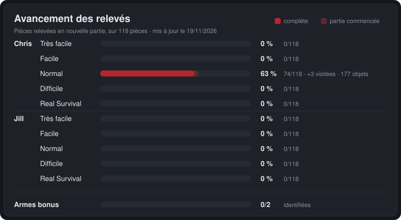

# Randomizer — Resident Evil HD Remaster (PC / Steam)

*English summary [below](#english).*

Mélange les objets du manoir à chaque partie. Une **graine** (un nombre) donne toujours le même mélange :
on peut donc jouer à plusieurs sur la même seed et comparer.

> Projet de fan, **non officiel**, sans lien avec Capcom. Aucun fichier du jeu n'est inclus : il faut
> posséder Resident Evil HD Remaster sur Steam.

## État : version 0.6 (test)

| Pris en charge | À venir |
|---|---|
| Chris, difficulté Normal | Jill, autres difficultés |
| 34 emplacements d'objets posés : munitions, herbes, rubans encreurs, poignards, trousses de premiers secours | Clés et objets de quête (avec une logique qui garantit que la partie reste finissable) |
| Option **armes aléatoires** (le pistolet du hall est mélangé lui aussi) | Davantage d'emplacements |

Les objets non pris en charge restent à leur place d'origine : la partie reste toujours finissable.

### Version du jeu requise

Le randomizer ne fonctionne qu'avec **une version précise** de `bhd.exe` (la version Steam actuelle) :
9 640 360 octets, SHA-256 `39B840663E4B1A6835C60CBD176E4EE6C21B9197FC2C2DD733F2A7C36A0B429A`.
L'application le vérifie. Sur une autre version, le randomizer se met en veille et le jeu reste intact.

## Avancement des relevés

Pourcentage de pièces relevées en **nouvelle partie** pour chaque personnage et difficulté (voir [Contribuer](#contribuer--relever-des-emplacements)). Mis à jour à chaque version.

<!-- progression:debut -->



<details><summary>Détail (texte)</summary>

| Personnage | Difficulté | Pièces complètes | Visitées (partie commencée) | Objets relevés |
|---|---|---|---|---|
| Chris | Très facile | 0/118 (0 %) | 0 | 0 |
| Chris | Facile | 0/118 (0 %) | 0 | 0 |
| Chris | Normal | 0/118 (0 %) | 26 | 73 |
| Chris | Difficile | 0/118 (0 %) | 0 | 0 |
| Chris | Real Survival | 0/118 (0 %) | 0 | 0 |
| Jill | Très facile | 0/118 (0 %) | 0 | 0 |
| Jill | Facile | 0/118 (0 %) | 0 | 0 |
| Jill | Normal | 0/118 (0 %) | 0 | 0 |
| Jill | Difficile | 0/118 (0 %) | 0 | 0 |
| Jill | Real Survival | 0/118 (0 %) | 0 | 0 |

Armes bonus : liste à compléter. Mis à jour le 17/11/2026.

</details>

<!-- progression:fin -->

## Installation (joueurs)

1. Télécharge le zip de la dernière version (`RandomizerREHD-v….zip` ; sur Linux / Steam Deck : `RandomizerREHD-v…-linux.tar.gz`, voir plus bas) dans l'onglet **Releases** et extrais-le où tu veux.
2. Lance `RandomizerREHD.exe`. Le dossier du jeu est trouvé automatiquement (sinon : « Parcourir… »).
3. Clique **Installer la DLL** (une seule fois).
4. Coche tes options, puis **Générer la seed** (laisse cochée « Installer la seed dans le jeu »).
5. Lance le jeu depuis Steam et commence une **nouvelle partie avec Chris en Normal**.

Pour changer de seed : générer une nouvelle seed, puis relancer le jeu.

**Windows SmartScreen / antivirus** : l'exe n'est pas signé (projet amateur), Windows peut afficher
« Windows a protégé votre ordinateur » → « Informations complémentaires » → « Exécuter quand même ».
Certains antivirus peuvent aussi signaler la DLL par erreur : elle utilise un point d'arrêt matériel
(comme Cheat Engine) pour lire l'objet ramassé. Le code source complet est dans ce dépôt.

### Linux / Steam Deck

Une version Linux native de l'application existe (`RandomizerREHD-linux`, un seul fichier) : sur Steam Deck,
passe en **mode Bureau**, rends le fichier exécutable (clic droit → Propriétés → Permissions → « Est
exécutable ») puis double-clique dessus. Le jeu est trouvé automatiquement dans la bibliothèque Steam.

Le jeu, lui, tourne toujours avec Proton : après **Installer la DLL**, copie l'option affichée dans la carte
*Jeu* (bouton **Copier**) et colle-la une fois dans Steam, *Propriétés du jeu → Options de lancement* :

```
WINEDLLOVERRIDES="xinput1_4=n,b" %command%
```

> Le fonctionnement de la DLL sous Proton n'a pas encore été confirmé sur un vrai Steam Deck : un retour
> (fichier `randomizer_journal.txt`) est le bienvenu.

### Revenir au jeu d'origine

Dans l'application : **Désinstaller la DLL**. (À la main : supprimer `xinput1_4.dll` du dossier du jeu.)
« Supprimer la seed installée » retire seulement la seed ; sans seed, la DLL ne change rien.

### Compatibilité

- **BhdTool** : compatible (il utilise `dinput8.dll`, le randomizer `xinput1_4.dll`).
- **Autre mod qui installe un `xinput1_4.dll`** : incompatible. L'application le détecte et n'y touche pas.
- **Cheat Engine** : ne pas lancer `appliquer_seed.lua` en même temps (même point d'arrêt).

## Signaler un problème

Dans l'application, bouton **Journal du jeu** : il ouvre `randomizer_journal.txt` (dossier du jeu).
Ouvre une *issue* en joignant ce fichier, avec la graine, les options et ce qui s'est passé.

## Comment ça marche

- `RandomizerREHD.exe` (Python + tkinter) tire une seed à partir du tableur `donnees_randomizer_RE1.xlsx`
  (emplacements relevés en jeu) et l'écrit dans le dossier du jeu sous le nom `randomizer_seed.lua`.
- `xinput1_4.dll` (C) se charge avec le jeu et transmet toutes les fonctions manette à la vraie DLL de
  Windows. Elle pose un point d'arrêt matériel sur `bhd.exe+1512ED` (lecture de l'objet ramassé) et,
  si l'emplacement (pièce + 8 valeurs fixes de la structure) est dans la seed, remplace l'identifiant et
  la quantité. Le code du jeu n'est jamais modifié.

## Compiler depuis les sources

Prérequis : Windows, Python 3 (`pip install openpyxl pyinstaller`), MSYS2 avec GCC 32 bits
(`pacman -S mingw-w64-i686-gcc`).

```bat
DLL\compiler.bat
Randomizer\construire_exe.bat
```

L'exe est créé dans `Randomizer\dist\`. Version Linux (sous Linux ou WSL, Ubuntu 22.04 conseillé pour
rester compatible avec le Steam Deck) : `sh DLL/compiler.sh` puis `sh Randomizer/construire_linux.sh`. Sans compiler : `python Randomizer\application.py`, ou en ligne
de commande `python Randomizer\generateur_seed.py 12345 --armes-aleatoires --installer`.

## Contribuer : relever des emplacements

Le plus simple : dans l'onglet **Aider le projet** de l'application, coche **Mode relevé**, lance une **nouvelle partie** et visite les
pièces. À chaque nouvelle pièce, les objets présents sont notés dans le journal du jeu, sans rien
ramasser (petite saccade d'environ 0,3 s à l'entrée). Envoie ensuite ce journal (bouton **Journal du jeu**)
dans une *issue*, en précisant le personnage et la difficulté. Pour l'ajouter au tableur :
`python Randomizer\importer_journal.py journal.txt --personnage Chris --difficulte Normal --nouvelle-partie --ecrire`
(sans `--nouvelle-partie` si la partie était déjà commencée : les pièces comptent alors comme simplement visitées).


Les scripts Cheat Engine de `outils/cheat_engine/` servent à relever de nouveaux objets
(`journal_objets.lua` note chaque objet ramassé avec son empreinte). Les relevés vont dans l'onglet
« Emplacements » du tableur. La DLL note aussi les objets inconnus dans son journal (« Non repertorie »).

## Crédits

- Noms et liaisons des pièces : `rooms.json` de **BhdTool** (eleval, GPLv3).
- Informations sur les verrous : **Evil Resource**.
- Inspiré des randomizers de la communauté (BioRand, ancien randomizer de Benn Powell).

## Licence

GPLv3 — voir [LICENSE](LICENSE).

---

## English

Item randomizer for **Resident Evil HD Remaster (Steam)**. Unofficial fan project; no game files included.

- **Version 0.6 (test)**: Chris / Normal only, 34 placed-item locations (ammo, herbs, ink ribbons, daggers,
  first aid boxes), optional *random weapons*. Keys, Jill and other difficulties are planned.
- **Requires** the current Steam `bhd.exe` (9,640,360 bytes, SHA-256 above). On any other version the
  randomizer stays inactive and the game is untouched.
- **Install**: download the zip from *Releases*, run `RandomizerREHD.exe`, click *Installer la DLL*, then
  *Générer la seed*, start a new game as Chris (Normal). The app is available in English, French, Japanese, Spanish, Portuguese, Russian and Chinese (language selector at the top right).
- **Uninstall**: *Désinstaller la DLL* (or delete `xinput1_4.dll` from the game folder).
- **Bug reports**: attach `randomizer_journal.txt` (button *Journal du jeu*) to an issue.
- Works alongside BhdTool. Unsigned exe: SmartScreen may warn; the DLL uses a hardware breakpoint, which
  some antivirus tools may flag. Full source is in this repository. License: GPLv3.
